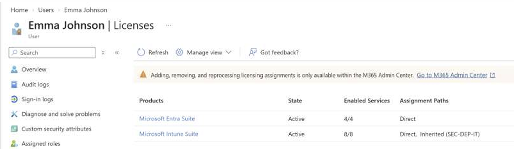
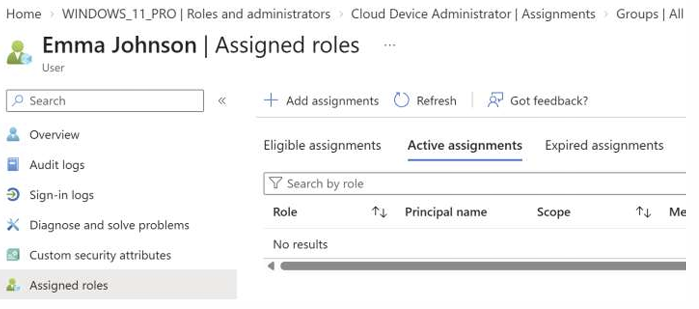
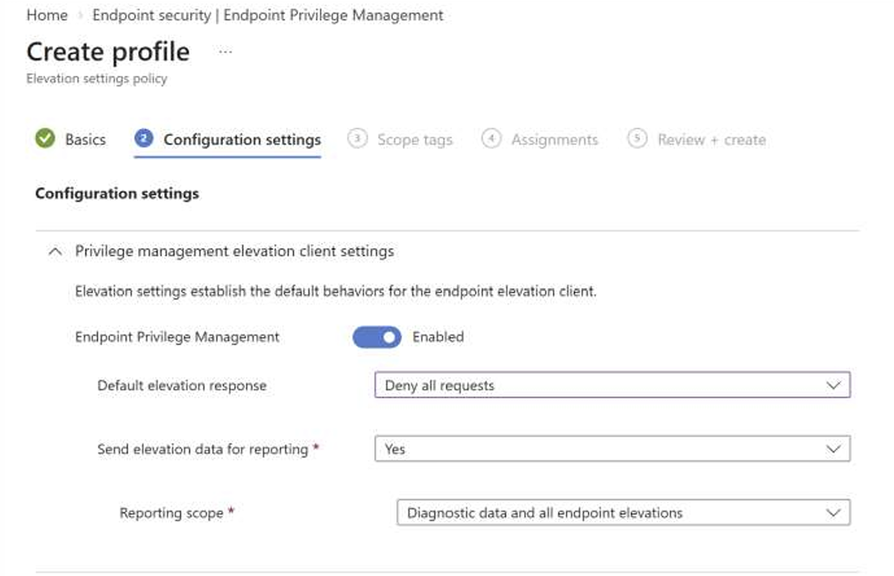
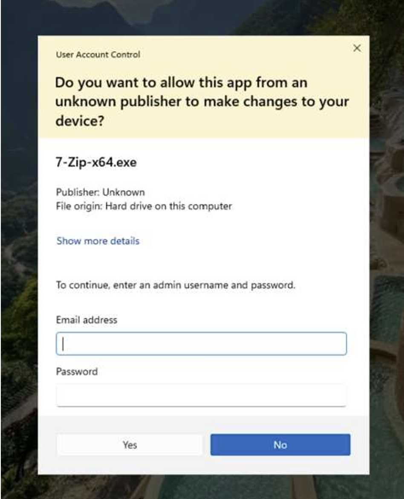
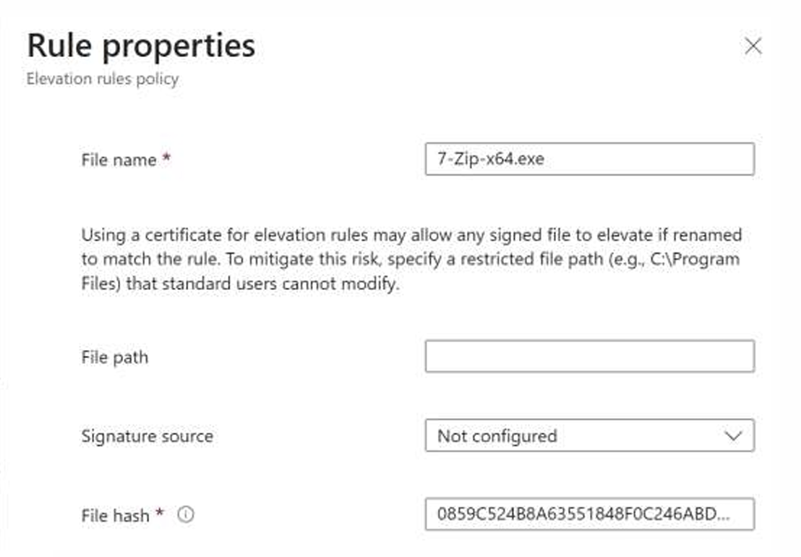
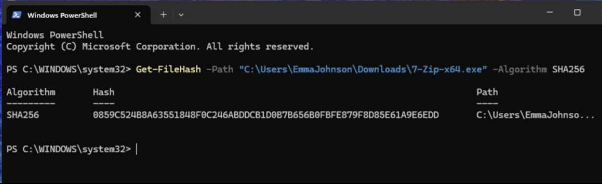
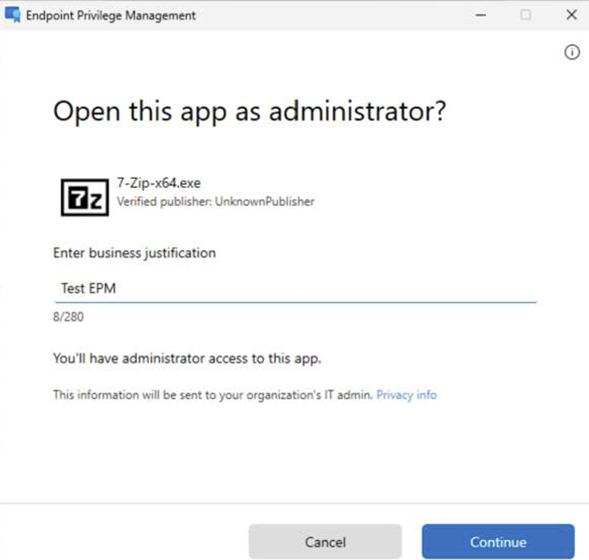
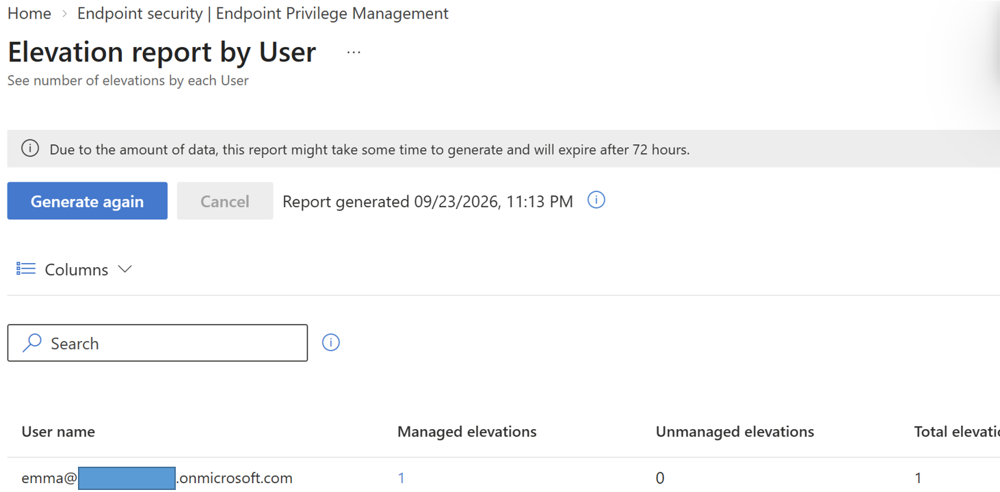

# Projekt 1: Endpoint Privilege Management (EPM) in Microsoft Intune

## 🎯 Ziel des Projekts
Das Ziel dieses Projekts war die Umsetzung des "Least Privilege"-Prinzips. Ein Standard-Benutzer sollte in der Lage sein, ein bestimmtes Programm sicher zu installieren, ohne dass er permanente lokale Administrator-Rechte bekommt.

## ⚙️ Umgebung
* **Gerät:** Windows 11 Pro (VMware).
* **Verbindung:** Microsoft Entra Joined und Microsoft Intune Enrolled.
* **Benutzer:** Standard-Benutzer (Emma Johnson).
* **Lizenzen:** Microsoft Entra Suite und Microsoft Intune Suite.

 

## 🛠️ Schritte der Umsetzung

**1. Benutzerrechte prüfen:**
Zuerst habe ich sichergestellt, dass der Test-Benutzer ("Emma Johnson") nur ein Standard-Benutzer ist und keine lokalen Administratorrechte besitzt. Das ist wichtig, da ein Administrator ohnehin jede Software ohne Einschränkungen installieren kann.

**2. Standard-Verhalten blockieren:**
Danach habe ich eine "Elevation settings policy" erstellt. Die Standardantwort (Default response) wurde auf "Deny all requests" gesetzt, um unautorisierte Installationen zu blockieren. Der normale Windows UAC-Dialog fragt nach einem Admin-Passwort und blockiert den Benutzer.

**3. EPM-Regel für 7-Zip erstellen:**
Ich habe eine "Elevation rules policy" für die Datei `7-Zip-x64.exe` erstellt. Zur Sicherheit wurde der SHA-256 Hash der Datei mit PowerShell (`Get-FileHash`) ausgelesen und in die Richtlinie eingetragen. Der Benutzer muss außerdem eine geschäftliche Begründung (Business Justification) angeben.

**4. Test und Ergebnis:**
Der Benutzer klickt mit der rechten Maustaste auf die Datei und wählt "Run with elevated access". Danach gibt er als Begründung z.B. "Test EPM" ein. Das Programm wird installiert. 

**5. Reporting prüfen:**
Um die Sicherheit zu überwachen, habe ich das Reporting aktiviert. Im Intune Admin Center kann man im "Elevation report by User" genau sehen, welcher Benutzer wann Rechte angefordert hat.

## 🤖 Automatisierung (PowerShell)
Um den Prozess der Hash-Generierung für zukünftige Anwendungen zu vereinfachen, habe ich ein kurzes PowerShell-Skript (`Get-AppHash.ps1`) geschrieben. 
Dieses Skript prüft, ob die Installationsdatei existiert, berechnet den SHA-256 Hash und gibt ihn übersichtlich aus. 

Den Code dazu finden Sie im Ordner `scripts/`.