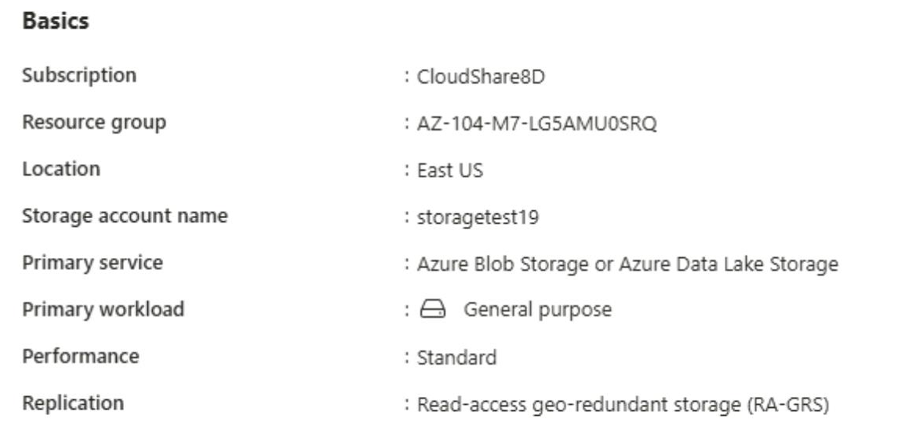
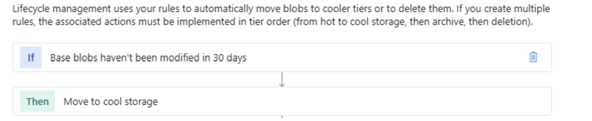
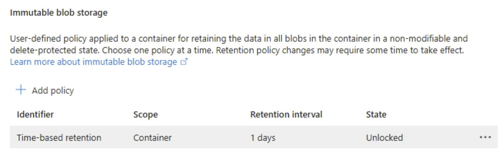
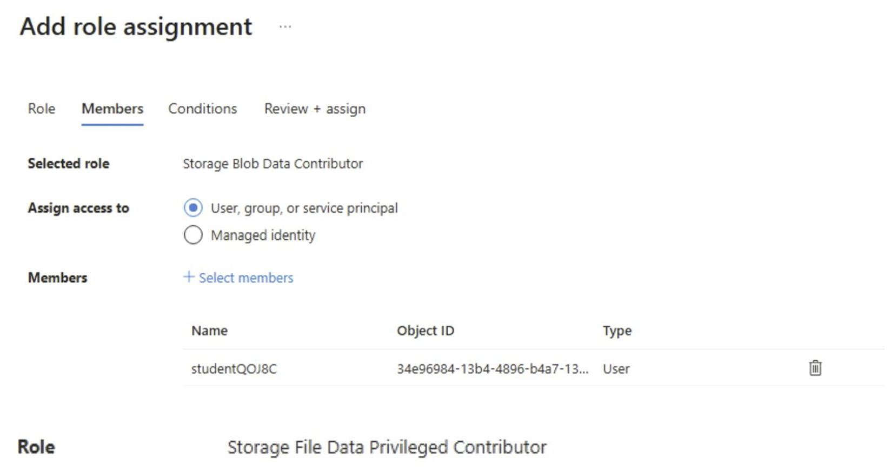
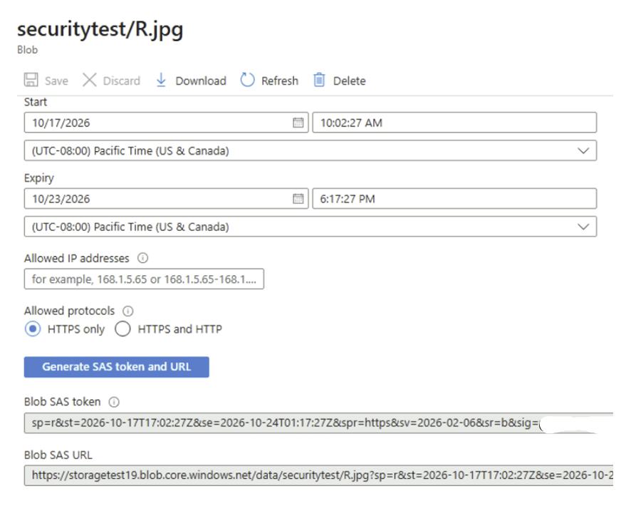
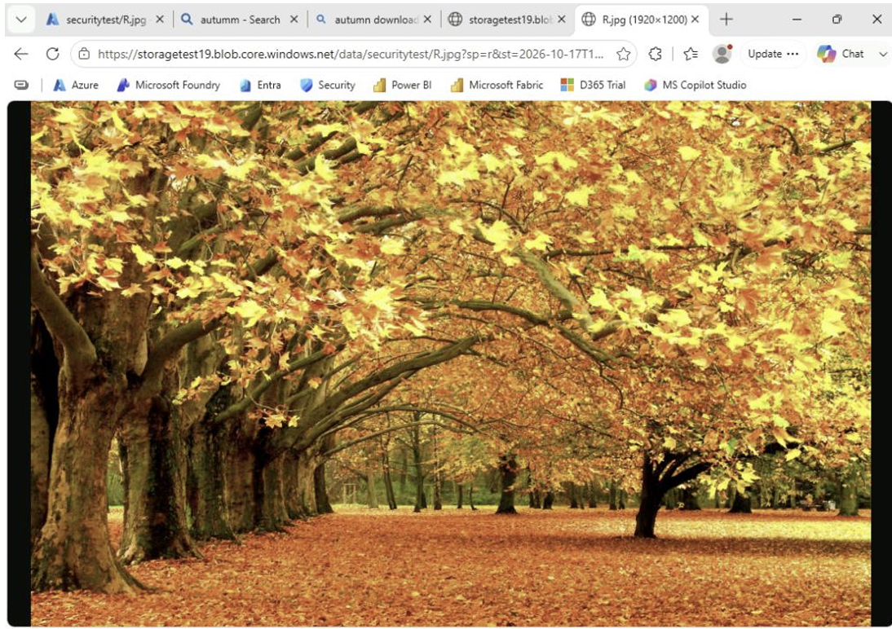
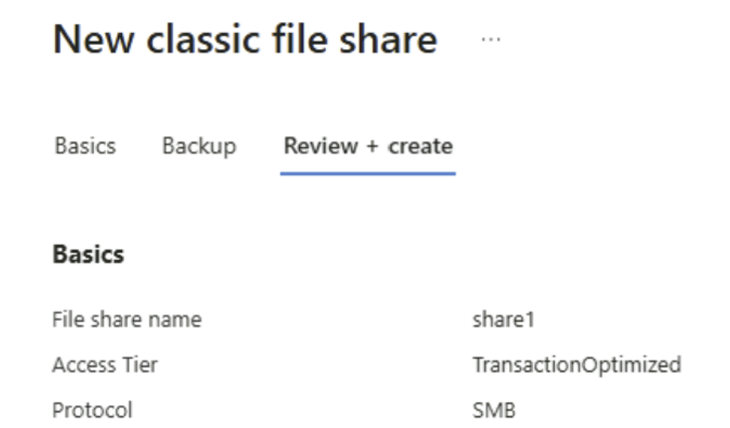
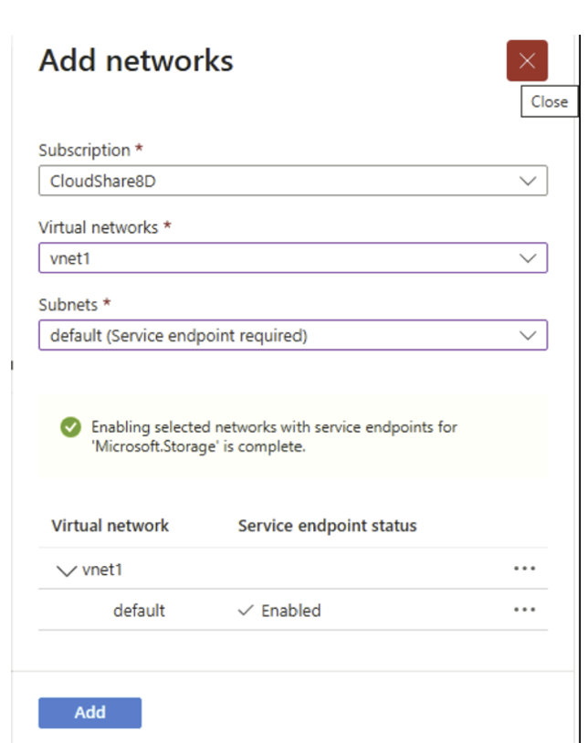
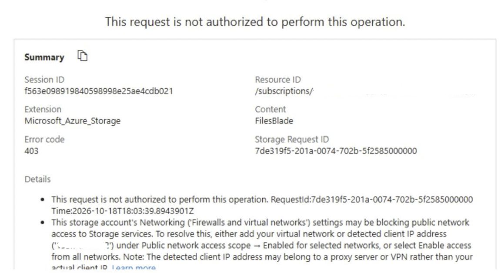

# Projekt 2: Azure Storage Security & Optimierung

## 🎯 Ziel des Projekts
Das Ziel dieses Projekts war der mehrstufige Schutz und die Kostenoptimierung eines georedundanten Azure-Speicherkontos. Der Fokus lag auf Netzwerk-Isolation, "Least Privilege"-Zugriff (IAM) und automatisiertem Lifecycle-Management. In diesem Projekt zeige ich, wie man sowohl externen Zugriff (über SAS) als auch strikt internen Zugriff (über VNet) sicher konfiguriert.

## ⚙️ Umgebung
* **Cloud-Plattform:** Microsoft Azure
* **Ressourcen:** Storage Account (Standard, East US, RA-GRS), Azure File Share, Blob Container.
* **Netzwerk:** Virtual Network (vnet1) mit Service Endpoints.

## 🛠️ Schritte der Umsetzung

**1. Erstellung und Kostenoptimierung (Lifecycle Management):**
Zuerst habe ich ein Speicherkonto erstellt. Ich habe "Read-access geo-redundant storage (RA-GRS)" gewählt, um die Daten auch bei einem kompletten regionalen Ausfall verfügbar zu halten. Um die Speicherkosten für das Unternehmen zu optimieren, habe ich eine Lifecycle-Management-Regel konfiguriert: Blobs, die 30 Tage lang nicht geändert wurden, werden automatisch in die günstigere Speicherebene "Cool" verschoben.

**2. WORM-Schutz und Azure RBAC (IAM):**
Für sensible Daten habe ich einen privaten Blob-Container erstellt und eine zeitbasierte Aufbewahrungsrichtlinie (Time-based retention) für einen Tag konfiguriert (WORM-Prinzip). Dadurch können die Daten innerhalb dieses Zeitraums weder geändert noch gelöscht werden – nicht einmal von Administratoren (Schutz vor Ransomware). Für den Zugriff habe ich das "Least Privilege"-Prinzip angewendet und meinem Benutzerkonto nur spezifische Azure-Rollen zugewiesen ("Storage Blob Data Contributor" und "Storage File Data Privileged Contributor"), anstatt globale Admin-Rechte zu vergeben.

**3. Sicherer temporärer, externer Zugriff (SAS):**
Um eine Datei sicher mit externen Personen zu teilen, habe ich eine Shared Access Signature (SAS-URL) generiert. Diese URL war zeitlich streng begrenzt (Start/Expiry time), bot nur Leserechte und verlangte zwingend das sichere HTTPS-Protokoll. Der Zugriff über diesen Link funktionierte im Browser problemlos, während ein direkter, anonymer Zugriff blockiert wurde.

**4. Netzwerk-Isolation für interne Daten (VNet Service Endpoint):**
Für den internen Gebrauch habe ich eine SMB-Dateifreigabe ("share1") mit der Zugriffsebene "Transaction optimized" erstellt. Um diese Daten komplett vor dem öffentlichen Internet zu verbergen, habe ich den Netzwerkzugriff auf das Speicherkonto stark eingeschränkt. Der Zugriff wurde über einen Service Endpoint ("Microsoft.Storage") ausschließlich auf ein spezifisches virtuelles Netzwerk ("vnet1") und dessen Subnetz beschränkt. 

**Ergebnis der Netzwerk-Isolation:** 
Praxistests haben bestätigt, dass das Speicherkonto sicher ist. Beim Versuch, von außen (über das öffentliche Internet) auf die Ressourcen zuzugreifen, lieferte Azure sofort die erwartete Fehlermeldung "HTTP 403 (This request is not authorized to perform this operation)". Der Zugriff ist nur noch aus dem sicheren Firmennetzwerk möglich.

## 🤖 Automatisierung (IaC mit Azure CLI)
In der Praxis werden solche Ressourcen oft per Code bereitgestellt. Ein einfaches Beispiel, um ein Speicherkonto sicher über die Kommandozeile zu erstellen, liegt im Ordner `scripts/` als `Create-Storage.azcli` bereit.